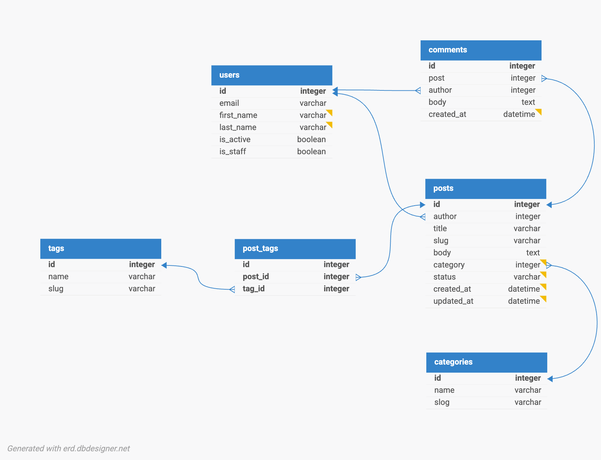
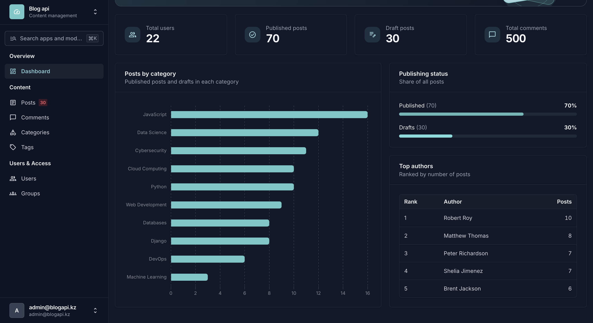
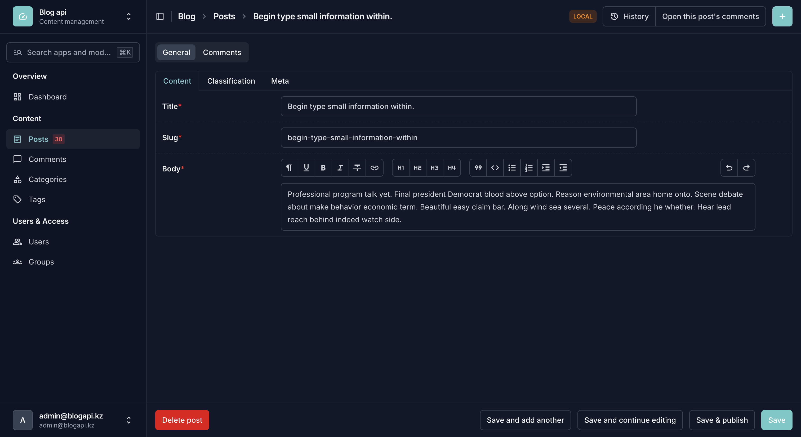
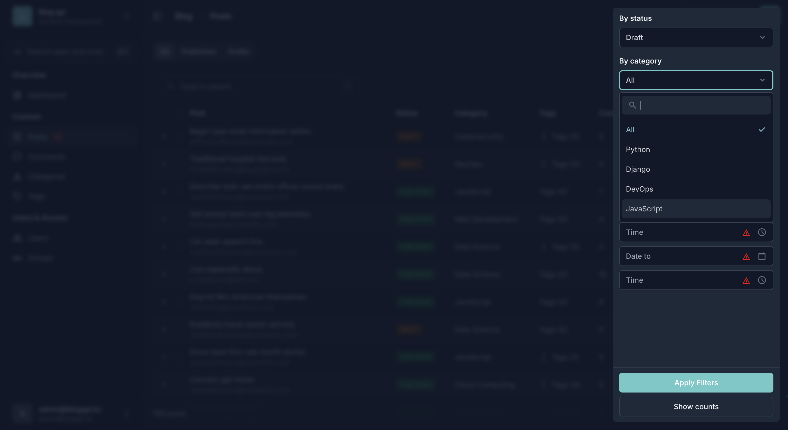
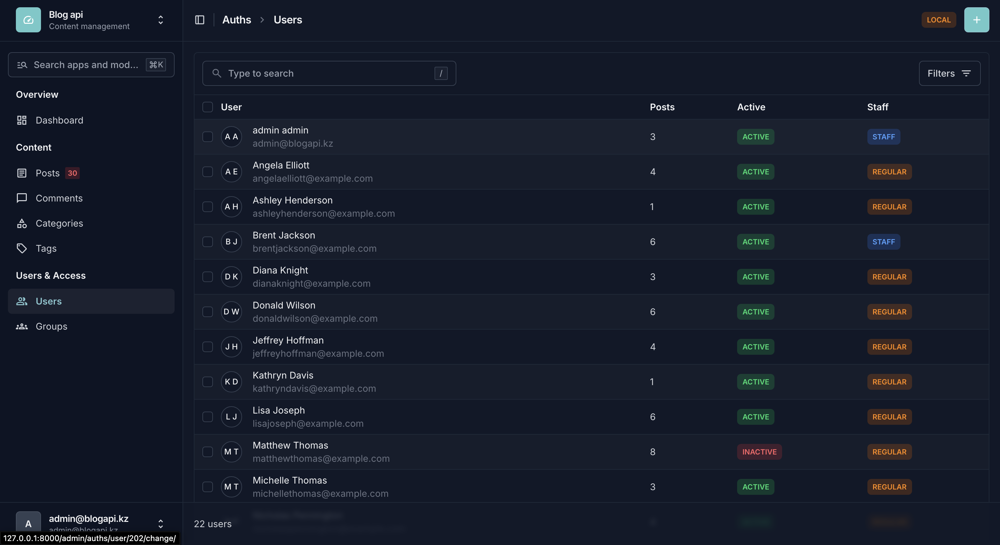

# Blog API

Django course project for a blog.

## Seed data

´python3 manage.py seed´ creates demo data for users, posts, comments, tags and categories

´´´
--users
--posts
--comments
--clear
´´´

Example of usage
´´´python
python3 manage.py seed --users 30 --posts 100 --comments 500 --clear
´´´

## Admin screenshots

#### Dashboard

#### Post edit page

#### Post list with filters open

#### Users list

