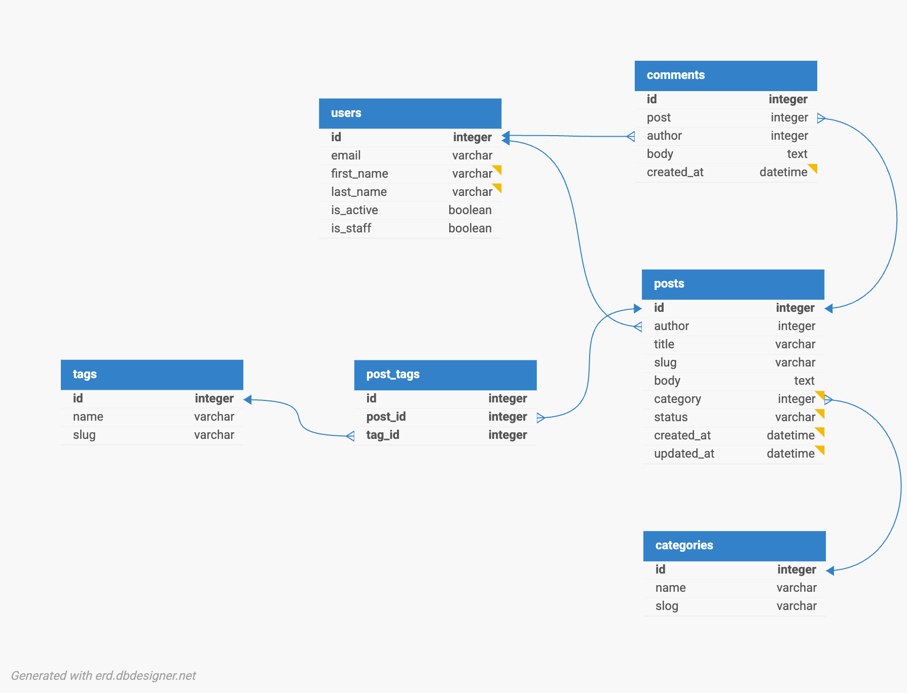
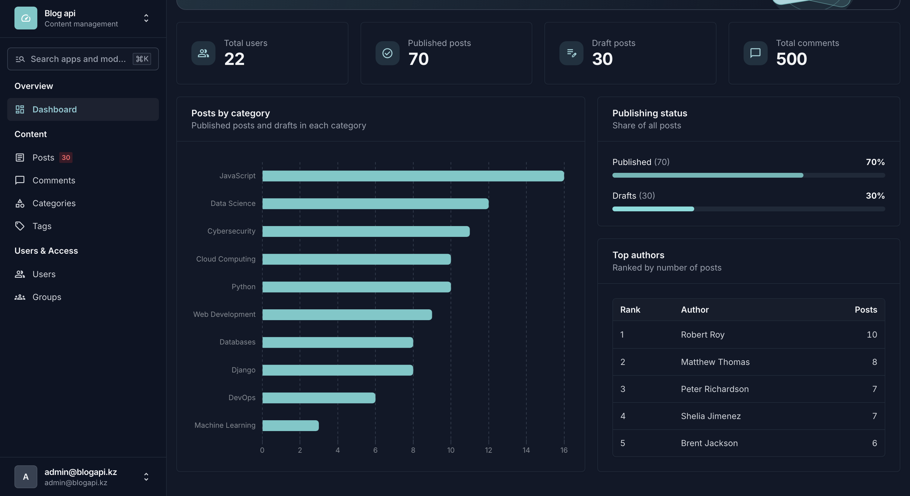
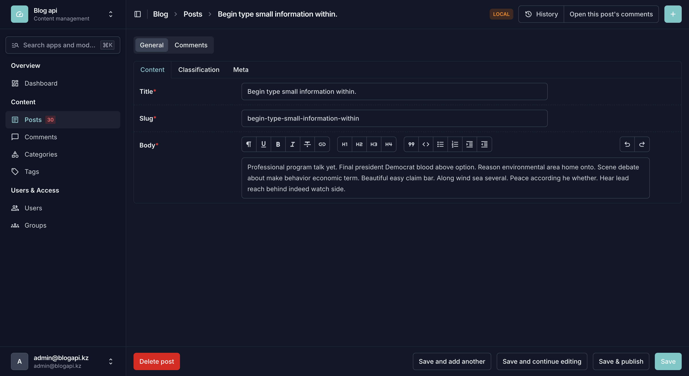
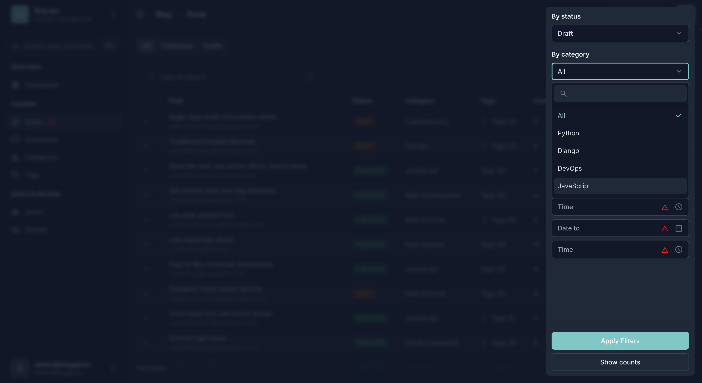
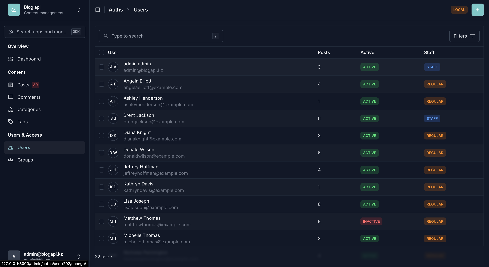

# Blog API

Django course project for a blog.



## Seed Data

`python3 manage.py seed` creates demo data for users, posts, comments, tags, and categories.

### Available options

```bash
--users       Number of users to create.
--posts       Number of posts to create.
--comments    Number of comments to create.
--clear       Clear existing demo data before generating new data.
```

## Admin screenshots

#### Dashboard



#### Post edit page



#### Post list with filters open



#### Users list



## Querries

`python3 manage.py querries` runs SQL queries on the Blog API's data.

```bash
--number    Specify the query number to execute.
--sql       Display the actual SQL query.
```
